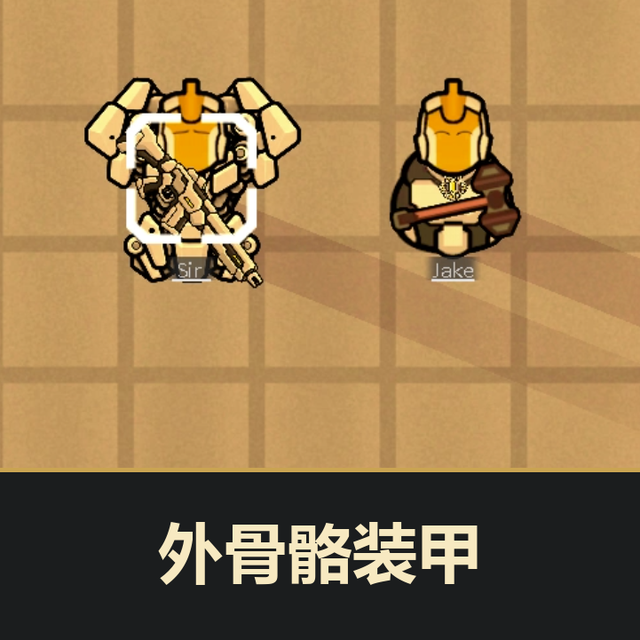

# 外骨骼装甲 / Exoskeleton Bionics



RimWorld **1.6 / 1.7** 的独立外骨骼 Mod，发布版本 **0.14.3**。本仓库只包含游戏运行文件和说明。

- 14种核心与四肢物品；核心永久植入，四肢通过“外骨骼管理”装卸、更换。
- 集齐左右手臂与左右腿后，过载触发20帧机甲变身；能量独立结算，亲自击杀回能。
- 核心与四肢共5件计级：蓝色／工业红色过载×1.5，金色×2.5。
- 首次吸收100单位金属形成护甲血条，此后材质持续保留；承担75%生命伤害，耐久随时自动恢复，2游戏小时从零回满。破甲使核心停机2游戏小时，期间暂停修复。
- 同页管理金属与四肢；护甲血条位于能量条上方。

## 物品介绍（0.14.3）

全部14种物品的中英文介绍改为说明实际用途、游戏表现和使用限制；物品、安装后状态与制作／安装配方的说明保持一致。介绍不再列出品质影响、公式与具体加成数值。装备名称、配置、配方、程序与美术保持原样。

## 安装

1. 点击本页 **Code → Download ZIP**，解压。
2. 将包含 `About`、`Common`、`Compatibility`、`LoadFolders.xml`、`1.6`、`1.7` 的整个目录放入 RimWorld 的 `Mods` 目录。
3. 在游戏的 Mod 列表启用“外骨骼仿生体 / Exoskeleton Bionics”，重启游戏。

只启用一个副本，不要同时加载本地版和同一Mod的工坊版。游戏会自动选择对应的版本目录。Harmony已内置；军用内容沿用皇权DLC条件。

工坊条目：[3826026606](https://steamcommunity.com/sharedfiles/filedetails/?id=3826026606)。本仓库上传不代表已更新Steam创意工坊。

## 兼容与验证

1.7版基于1.7.4985编译，使用.NET 10与Harmony 3；1.6版保留原0.13.3 DLL与Harmony 2.4.3。物品定义、语言、贴图与许可在 `Common` 中共用，版本目录只放对应程序集。

```text
About/               Mod信息、封面和工坊编号
Common/
  Defs/              共用物品与功能定义
  Languages/         共用中英文文本
  Textures/          共用贴图
  Licenses/          Harmony许可
1.6/Assemblies/      1.6专用Mod DLL与Harmony 2
1.7/Assemblies/      1.7专用Mod DLL与Harmony 3
Compatibility/
  CombatExtended/   启用CE时按游戏版本加载的小型兼容模块
LoadFolders.xml      每个版本加载Common及自身目录
```

此结构通过加载路径共用同一套资源；两个版本的程序集分别保留，不能互换。后续若出现版本专用定义或贴图，可放入对应版本目录，避免复制全部公共内容。

0.14.0基础功能已通过625项1.7隔离引擎检查，覆盖变身／战斗、金属护甲、管理界面、独立能量与旧存档迁移；本次保留基础DLL与贴图原字节。

## 金属护甲自动修复（0.14.2）

- 首次或更换材质消耗100单位金属。同一种材质装填一次即可，阻止重复装填。
- 战斗、普通状态与机甲状态均自动修复；每游戏小时恢复上限的50%，从零回满为5,000 ticks（2游戏小时），不额外消耗金属或能量。
- 耐久耗尽仍立即解除机甲并使核心停机2游戏小时，期间不修复；停机结束后恢复修复。从破甲到满耐久合计最多4游戏小时。
- 退出机甲保留材质并继续修复。死亡停止修复；清空材质停止修复；清空或更换材质直接丢弃旧金属，不退料；更换材质消耗100单位新金属。
- 旧存档中仍有金属材质的护甲自动接入修复，包括耐久为0的护甲；未装填或已清空的不生成护甲。存档重载保留当前耐久，不赠送离线修复。

本次自动修复已在1.7.4985隔离引擎中通过39项未启用CE检查和40项CE联测，覆盖实际承伤、游戏循环、停机到期、清空换材不退料、管理按钮及真实存档重载。1.6对应模块已完成编译和CLR4引用检查，尚未在1.6引擎中运行。

## Combat Extended

启用CE后会自动加载兼容模块。请按CE自身依赖启用Harmony，并将CE放在本Mod之前。未启用CE时，兼容DLL不会加载。

- 完整机甲按装甲颜色放大CE弹丸、近战与生命伤害类附加伤害；普通状态和缺件过载保留原武器伤害。
- 沿用实际装备武器和CE弹药，不绕过空弹匣、装填、射程或散布；兼容模块不放大穿甲，也不放大暴击产生的非生命伤害效果。
- 弹丸在发射时保存倍率；退出过载、换装和存档重载后，飞行中的弹丸保持原倍率。旧CE弹丸没有新字段时按原伤害加载。
- 保留大剑与步枪的尺寸、四方向握点、装甲配色和侧面前层显示；机甲外观采用内置武器贴图。
- 金属护甲继续吸收75%生命伤害，破甲停机2游戏小时；首次装填后保留材质并自动修复，核心停机期间暂停。金属吸收、清空、更换和部件安装／拆卸后同步CE携带重量缓存。
- 如部件含搬运重量词条，按已有数值与过载倍率映射到CE重量容量；CE体积限制保持原值。

| 环境 | 本次验证 |
| --- | --- |
| RimWorld 1.7.4985 + 本机CE 16.7.4.0 | 108项隔离引擎联测通过：真实射击耗弹、弹丸命中、伤害／穿甲、近战、持械、护甲、库存、击杀回能及存档 |
| RimWorld 1.7.4985，未启用CE | 3项启动／原版行为检查通过，兼容程序集不加载 |
| RimWorld 1.6.4871 | 对应兼容DLL编译和CLR4引用检查通过；尚未在1.6引擎中联测 |

本机CE仍仅声明支持1.6；上表的1.7结果为这两个具体版本的联合验证。用户殖民地、其他CE版本和第三方武器组合仍需实际验收。

## 第三方许可

Harmony的MIT许可保留于 `Common/Licenses/Harmony-MIT.txt`。游戏原始参考素材、开发源码、工具、测试、原画和历史备份均不包含在本仓库。
